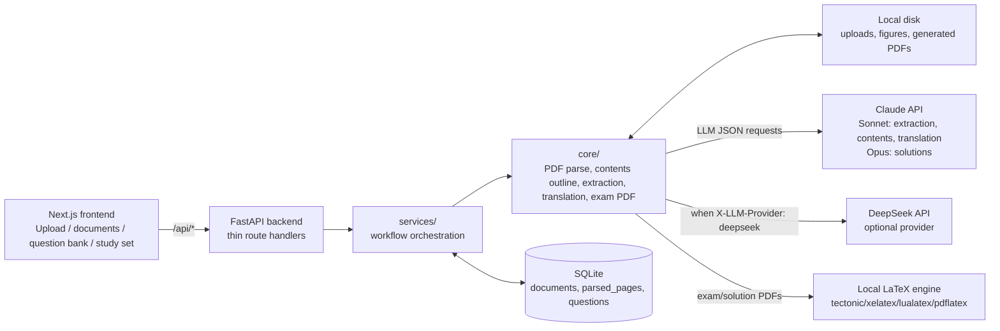

# Study Question Generator

Full-stack app for university exam prep. Upload textbook or sample-exam PDFs, the backend parses pages and figures with PyMuPDF, Claude reads each rendered page image and extracts student-solvable questions with LaTeX math intact, and the frontend lets you browse the question bank or generate random study sets and exam PDFs.

- **Backend:** FastAPI + SQLAlchemy + SQLite
- **Frontend:** Next.js App Router (React 19, Tailwind v4)
- **PDF parsing:** PyMuPDF (`fitz`)
- **LLM:** Anthropic Claude (Sonnet 4.6 for extraction/outline/translation, Opus 4.7 for solutions). DeepSeek available via the Anthropic-compatible endpoint when the request sends `X-LLM-Provider: deepseek`.
- **Math:** KaTeX
- **Exam PDF:** local LaTeX (`tectonic` recommended)

---

## Architecture



## Workflow

1. Upload
   - Frontend sends `POST /api/upload` with `file`, `document_role`, `subject`, and `pdf_scope`.
   - Textbook upload uses `pdf_scope=full`; sample exam upload uses `pdf_scope=chapter`.
   - Backend validates `%PDF-`, stores the PDF in `backend/data/uploads`, and creates a `Document(status=uploaded)`.

2. Parse
   - Frontend calls `POST /api/documents/{id}/process` when the user clicks **Parse**.
   - Backend uses PyMuPDF to persist every page as `ParsedPage(raw_text, cleaned_text, figures)`.
   - For chapter PDFs, local heading detection builds a simple chapter outline.
   - For full PDFs, the backend extracts text-readable contents pages and first parses numbered entries locally. If the local parser cannot produce a usable outline, Claude Sonnet is used as a fallback JSON normalizer. A local repair pass preserves multiline chapter/section entries and resolves PDF page ranges from printed contents page labels.
   - Parse does not extract questions from a full PDF. It only prepares contents selection.

3. Extract
   - For full PDFs, the user selects one or more contents entries, then frontend calls `POST /api/documents/{id}/extract` with `chapter_ranges`.
   - For chapter PDFs, extraction can run over the parsed chapter document directly.
   - Backend renders selected PDF pages to PNG and sends page images to Claude Sonnet for question extraction. The LLM returns JSON only.
   - Extracted questions are stored in SQLite with chapter, subject, page, normalized text, confidence, and figure references.

4. Browse and generate
   - Question bank uses `GET /api/questions` plus subject/chapter/search filters.
   - Translation uses `POST /api/questions/{id}/translate` and Claude Sonnet.
   - Random study sets and exam PDFs use stored questions; exam PDFs use local LaTeX, not an LLM.
   - Solution PDFs call Claude Opus for explanations, then use local LaTeX.

## LLM API Calls

The backend is the only place that reads API keys. The frontend only sends `X-LLM-Provider: claude | deepseek`.

| Moment | Module | Default model | Input |
|---|---|---|---|
| Full PDF parse contents fallback | `core/chapter_outline_extractor.py` | Claude Sonnet 4.6 | text from contents pages |
| Question extraction | `core/question_extractor.py` | Claude Sonnet 4.6 | rendered page PNGs |
| Korean translation | `core/question_translator.py` | Claude Sonnet 4.6 | stored question text |
| Solution PDF | `core/solution_generator.py` | Claude Opus 4.7 | selected stored questions |

If provider is `deepseek`, the backend uses `deepseek-v4-pro`. DeepSeek is text-only in this project, so image-based extraction requires Claude.

---

## Local development

Prereqs: Python 3.11+, Node 20+, a LaTeX engine in PATH (`tectonic` is easiest).

```bash
# Backend
cd backend
python -m venv .venv && source .venv/bin/activate
pip install -r requirements.txt
cp .env.example .env       # then fill in ANTHROPIC_API_KEY
uvicorn app.main:app --reload

# Frontend (new terminal)
cd frontend
npm install
npm run dev
```

Open http://localhost:3000. Backend runs on http://localhost:8000.

```bash
# Tests
cd backend && source .venv/bin/activate && python -m pytest tests/ -v
cd frontend && npm run lint && npx tsc --noEmit

# End-to-end smoke
backend/.venv/bin/python scripts/workflow_smoke.py
```

---

## Hosting on the web

> **This stack will not run end-to-end on Vercel alone.** Vercel's serverless runtime cannot host the FastAPI backend the way it's currently written: it needs a persistent filesystem (uploaded PDFs, extracted figures, the SQLite DB), long-running requests for PDF parsing and LLM calls, and a LaTeX binary on disk for exam-PDF generation.
>
> The working pattern is **Vercel for the frontend, a separate container host for the backend**. Both halves are linked by a public URL and a CORS allowlist.

### Recommended split

| Piece | Host | Why |
|---|---|---|
| `frontend/` (Next.js) | **Vercel** | Native Next.js host, free tier is fine |
| `backend/` (FastAPI + SQLite + tectonic) | **Railway** or **Render** or **Fly.io** | Persistent disk, long requests, can install LaTeX |

### Step 1 — rotate API keys

The keys that have been in `backend/.env` on this machine should be rotated before any public deployment:

- Anthropic: https://console.anthropic.com/settings/keys → revoke the old key, create a new one.
- DeepSeek: https://platform.deepseek.com/api_keys → same.

Put the **new** keys into your hosting provider's env-var dashboard. Never commit them.

### Step 2 — deploy the backend (Railway example)

1. Push the repo to GitHub.
2. In Railway, **New Project → Deploy from GitHub Repo**, point it at this repo.
3. Set the service root directory to `backend/`.
4. Add a build-time install step so `tectonic` is available. The simplest way is to add a `Dockerfile` at `backend/Dockerfile`:

   ```dockerfile
   FROM python:3.12-slim

   RUN apt-get update && apt-get install -y --no-install-recommends \
         tectonic ca-certificates \
       && rm -rf /var/lib/apt/lists/*

   WORKDIR /app
   COPY requirements.txt .
   RUN pip install --no-cache-dir -r requirements.txt

   COPY . .
   RUN mkdir -p data/uploads data/figures data/generated_exams

   ENV PORT=8000
   CMD ["sh", "-c", "uvicorn app.main:app --host 0.0.0.0 --port ${PORT}"]
   ```

   If `tectonic` is not in your distro's apt repo, swap to `texlive-xetex` (heavier) or download the `tectonic` static binary in the Dockerfile.

5. Add a **Volume** mounted at `/app/data` so uploads, figures, generated PDFs, and the SQLite DB survive restarts.
6. Set environment variables in the Railway dashboard:

   ```
   ANTHROPIC_API_KEY=sk-ant-...           # the rotated key
   DEEPSEEK_API_KEY=sk-...                 # optional
   DEBUG=false
   DATABASE_URL=sqlite:////app/data/study_questions.db
   UPLOAD_DIR=/app/data/uploads
   FIGURE_DIR=/app/data/figures
   GENERATED_EXAM_DIR=/app/data/generated_exams
   CORS_ORIGINS=https://your-frontend.vercel.app
   ```

7. Deploy. Railway gives you a URL like `https://study-qgen-backend.up.railway.app`. Hit `/health` to confirm.

Render and Fly.io follow the same pattern: Dockerfile, persistent volume mounted at `/app/data`, env vars, public URL.

### Step 3 — deploy the frontend (Vercel)

1. Vercel → **Import Git Repository** → select this repo.
2. **Root directory:** `frontend/`. Vercel auto-detects Next.js.
3. Add environment variable:

   ```
   NEXT_PUBLIC_API_URL=https://study-qgen-backend.up.railway.app
   ```

   (your backend URL from step 2; no trailing slash).
4. **Update `frontend/next.config.ts`** so `next/image` accepts the production figure URLs. Add an entry under `remotePatterns` for your backend host:

   ```ts
   { protocol: "https", hostname: "study-qgen-backend.up.railway.app", pathname: "/api/assets/figures/**" }
   ```

5. Deploy. Vercel gives you `https://your-frontend.vercel.app`.

### Step 4 — wire CORS

Back in the Railway/Render dashboard, set:

```
CORS_ORIGINS=https://your-frontend.vercel.app
```

(or comma-separate multiple origins if you want preview deploys to work). Restart the backend service.

### Step 5 — sanity check

- `curl https://your-backend/health` → `{"status":"ok",…}`
- Open the Vercel URL, upload a small PDF, click Parse, click Extract.
- Try generating an exam PDF; if you get `No LaTeX engine found`, the Dockerfile didn't install `tectonic`.

### If you really want everything on Vercel

It is possible, but it's a refactor, not a config change:

- Replace SQLite with a hosted Postgres (Vercel Postgres / Neon / Supabase).
- Replace the local `data/uploads` and `data/figures` directories with S3-compatible blob storage (Cloudflare R2, Vercel Blob, Supabase Storage). Every read/write of a PDF or figure has to go through that client.
- Replace the LaTeX exam generator with either an HTML→PDF service (DocRaptor, Browserless, Gotenberg) or drop the feature.
- Move every `/api/*` route into `frontend/src/app/api/.../route.ts` (Next.js Route Handlers) so they run as Vercel functions. Long-running PDF parsing must fit inside the function timeout (60s on Pro; otherwise chunk the work and run it on a queue).
- Add a queue for extraction (Inngest / Trigger.dev / Upstash QStash) since a serverless function is the wrong place for a multi-page Claude extraction.

That is roughly a one-week rewrite. Use the split-host approach above unless you have a strong reason not to.

---

## Project layout

```
backend/app/
  api/         thin route handlers
  services/    workflow orchestration and DB writes
  core/        PDF parsing, contents outline, question extraction,
               translation, solutions, exam PDF, random selection, LLM runtime
  models/      SQLAlchemy ORM: Document, ParsedPage, Question, PracticeSession
  schemas/     Pydantic request/response models
  prompts/     extraction system prompt
  db/          engine, session, runtime schema patcher
backend/tests/
frontend/src/
  app/         pages: /, /questions, /study-set
  components/  FileUpload, DocumentList, QuestionCard, QuestionFilter,
               QuestionDetail, MathText, ModelSelector
  lib/         api client, shared types
scripts/       full_project_check.py, workflow_smoke.py
```

## Local data locations

- Uploaded PDFs: `backend/data/uploads`
- Extracted figures: `backend/data/figures`
- Generated exam PDFs: `backend/data/generated_exams`
- SQLite DB: `backend/data/study_questions.db`

Use **Reset All** on the upload page to clear everything locally.
